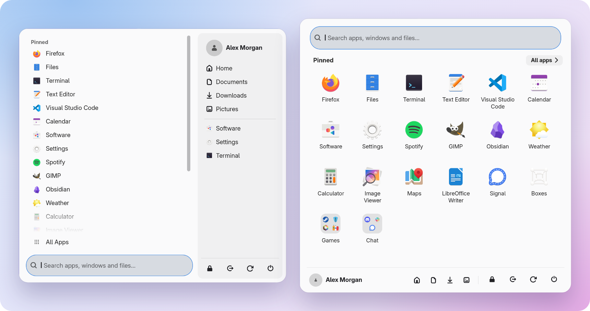
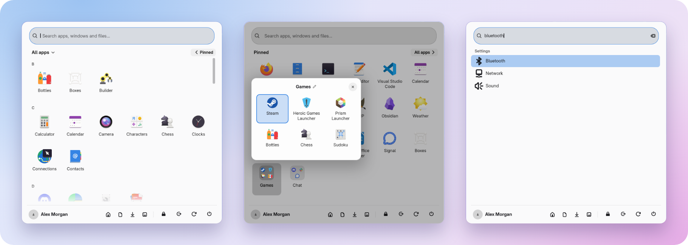
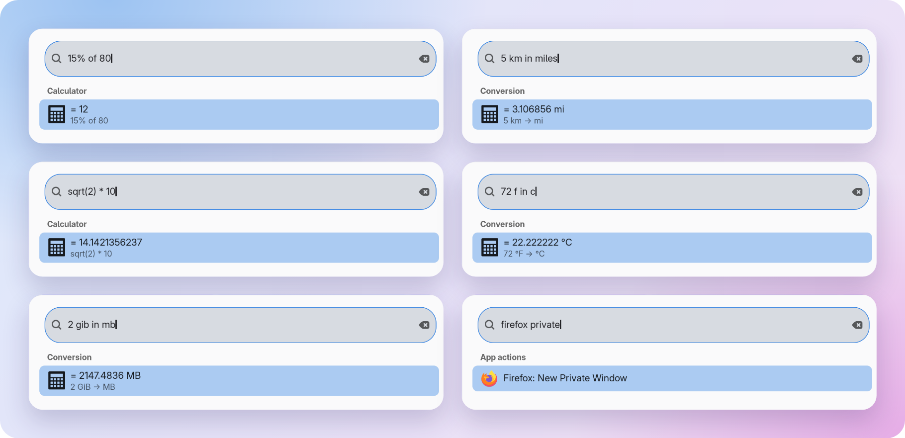

<p align="center">
  
</p>

<h1 align="center">Spawn</h1>

<p align="center">
  <strong>Your apps, one keystroke away.</strong><br>
  A fast, tidy app menu for GNOME Shell, with a search box that answers back.
</p>

<p align="center">
  GNOME Shell 49 · 50 · 51 &nbsp;|&nbsp; Fedora 43 · 44 · 45 &nbsp;|&nbsp; signed packages &nbsp;|&nbsp; GPL-2.0-or-later
</p>

<p align="center">
  <a href="#install"><strong>Install</strong></a> ·
  <a href="#why-spawn">Why Spawn</a> ·
  <a href="#search-that-answers">Search</a> ·
  <a href="docs/SETTINGS.md">Settings</a> ·
  <a href="CHANGELOG.md">What's new</a>
</p>

<p align="center">
  <picture>
    <source media="(prefers-color-scheme: dark)" srcset="docs/screenshots/hero-dark.png">
    
  </picture>
</p>

Press Super and your apps, folders, search and power buttons are there. Spawn is a lighter, sturdier replacement for
[ArcMenu](https://gitlab.com/arcmenu/ArcMenu), and it brings your ArcMenu setup over in one click.

## Why Spawn

<table>
  <tr><td><strong>Two layouts</strong></td><td><em>Classic</em> has two panes: pinned apps on the left, as a list or an icon grid; folders, shortcuts and power on the right. <em>Grid</em> is one calm column of large icons, a page at a time.</td></tr>
  <tr><td><strong>Search that answers</strong></td><td>Apps, Settings panels and app actions, with one best match on top. Sums, conversions, time zones, dates and more are answered as you type.</td></tr>
  <tr><td><strong>Pins and folders</strong></td><td>Drag to arrange, drop one app onto another to make a folder, drag from All apps to pin. Pinning, unpinning, hiding an app and deleting a folder can all be undone.</td></tr>
  <tr><td><strong>Fast</strong></td><td>Opens in about 20 ms and keeps up with your typing, even with hundreds of apps.</td></tr>
  <tr><td><strong>At home on your desktop</strong></td><td>Works with Dash to Panel, opens over fullscreen games, and follows your accent colour and light or dark style.</td></tr>
  <tr><td><strong>For everyone</strong></td><td>Full keyboard control and screen reader support.</td></tr>
  <tr><td><strong>Tidy by default</strong></td><td>Hide apps you never use, spot newly installed ones by their badge, and back up or restore your whole setup in one file.</td></tr>
  <tr><td><strong>Easy to move in</strong></td><td>Import settings, pinned apps and folders from ArcMenu in one click, with Undo.</td></tr>
</table>

<p align="center">
  <picture>
    <source media="(prefers-color-scheme: dark)" srcset="docs/screenshots/gallery-dark.png">
    
  </picture>
</p>

## Search that answers

Start typing as soon as the menu opens. The best match is already selected, so Return is usually all you need.
For an answer, Return copies it to the clipboard. Everything works offline: nothing you type leaves your computer.

<p align="center">
  <picture>
    <source media="(prefers-color-scheme: dark)" srcset="docs/screenshots/answers-dark.png">
    
  </picture>
</p>

| You want | Type, for example | You get |
|---|---|---|
| A sum | `15% of 80` · `20% off 80` · `sin(30°)` · `5!` | `= 12` · `= 64` · `= 0.5` · `= 120` |
| A conversion | `5 ft 10 in in cm` · `72 f in c` · `30 mpg in l/100km` | `= 177.8 cm` · `= 22.222222 °C` · `= 7.8404861 l/100km` |
| The time somewhere | `time in tokyo` · `3pm london in tokyo` | The time there, or your time converted |
| A date | `days until 25 dec` · `today + 90 days` · `week number` | The count, the date or the week |
| A network worked out | `192.168.1.130/26` | Network, host range, mask, broadcast and host count |
| A number or a colour | `255 in hex` · `#3584e4` | `0xFF` · the colour as RGB, HSL and hex, with a sample |
| A password or an ID | `password 24` · `uuid` · `sha256 hello` | A random password or UUID, or the hash of your text |
| An emoji or a symbol | `emoji smile` · `symbol pi` | The character, ready to copy |
| A quick setting | `dark mode` · `night light` · `wifi off` | The switch, flipped when you press Return |
| A Settings panel | `bluetooth` · `display` | The panel, opened directly |
| An app's action | `firefox private` | Firefox: New Private Window |
| A power action <sup>1</sup> | `lock` · `restart` · `power off` | The action, with the usual confirmation |
| A window or a recent file <sup>1</sup> | part of its name | The window, or the file in its app |

<sup>1</sup> Off by default. Every row above has its own switch under Settings > Menu > Search sources.

**[Everything the search box understands](docs/SEARCH.md)**: every function, unit, time zone form and tool.

Prefer a bare search box? The **runner** is a small pop-up with the same search and its own shortcut (off until you
set one). It can also run a typed command, if you switch that on.

## Install

Spawn comes from its own signed repository for Fedora 43, 44 and 45:

```sh
sudo dnf config-manager addrepo --overwrite --from-repofile=https://djshiye.github.io/spawn/spawn.repo
sudo dnf install -y spawn && spawn-enable
```

Then log out and back in. The first time, dnf asks you to accept the signing key: check that its fingerprint is

```
D49A 3081 6825 7FDB F9D5  AE14 BD1A C1C6 F56A 7252
```

- **Update:** `sudo dnf upgrade`, then log out and back in. Spawn reminds you when an update is waiting.
- **Uninstall:** `spawn-enable --remove; sudo dnf remove spawn`

**Fedora Glass:** [Fedora Glass](https://github.com/djshiye/fedora-glass) 1.5.6 and later themes Spawn the way it
themes ArcMenu (its "Spawn" entry, under Panel). Import from ArcMenu before you apply Glass, so Spawn's own colours are
the ones Glass's Restore original puts back.

## More

- [What changed in each release](CHANGELOG.md) and [what comes next](ROADMAP.md).
- [Every setting](docs/SETTINGS.md), and how it maps from ArcMenu.
- [Building, testing and releasing Spawn](docs/DEVELOPING.md).
- Found a security problem? See [SECURITY.md](SECURITY.md).

## Credits and licence

Based on research into ArcMenu (https://gitlab.com/arcmenu/ArcMenu), GPL-2.0-or-later. Spawn is a derivative work
under the same licence. ArcMenu's icon set and a copy of its settings schema (used only to migrate settings) are
bundled. See `LICENSE`.
