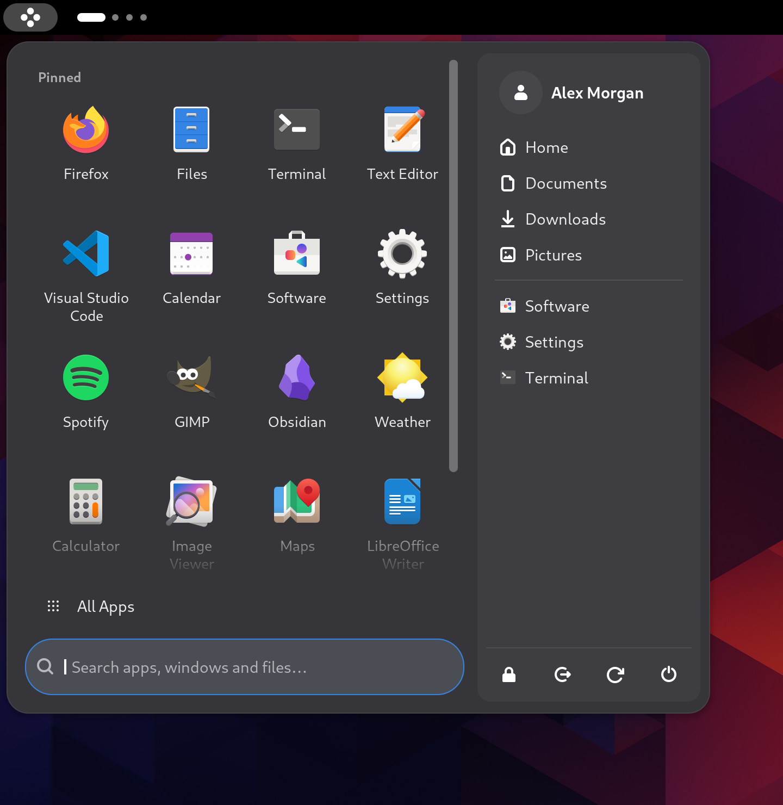
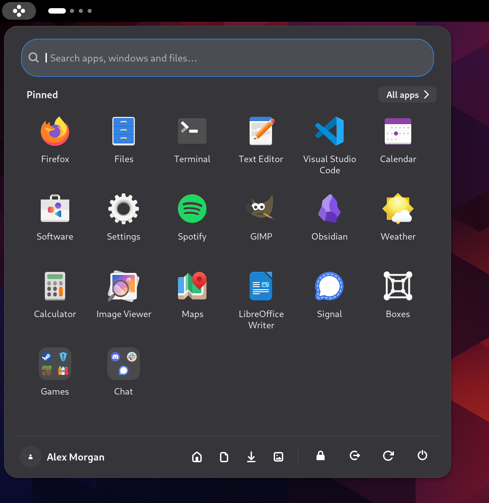
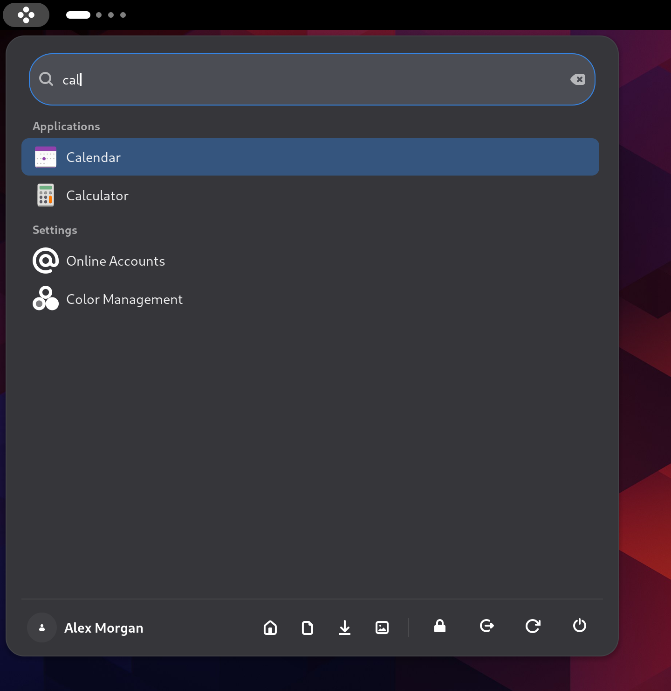
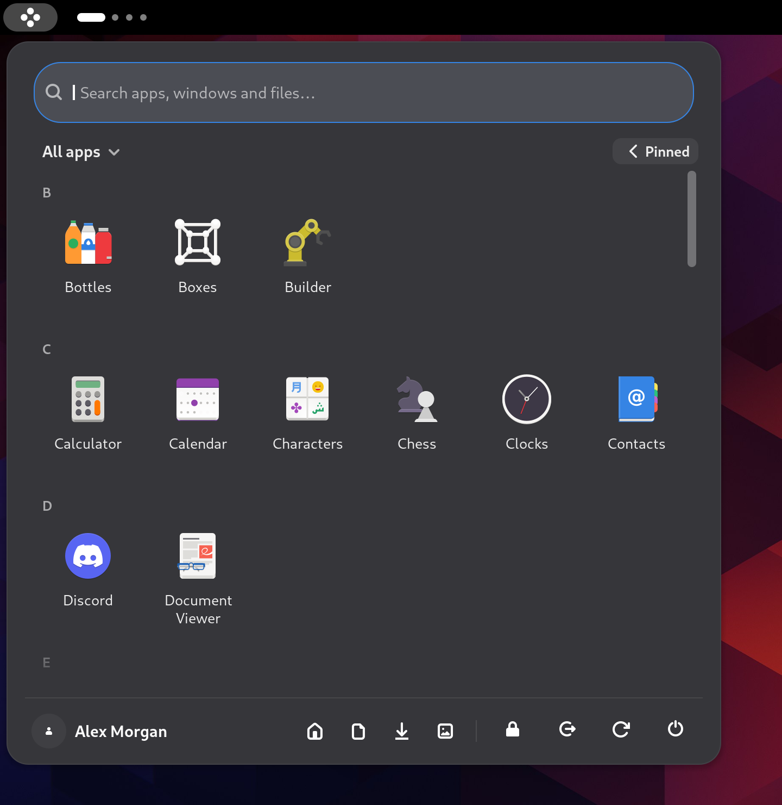
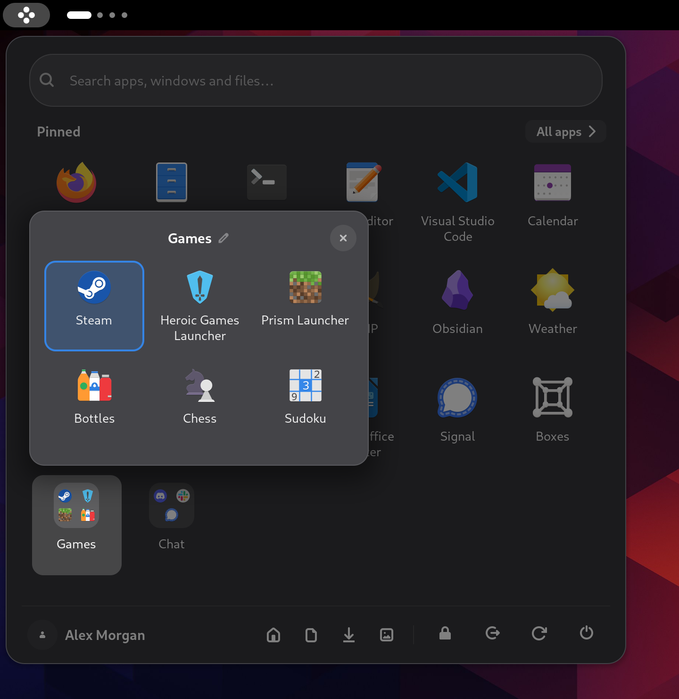

# Spawn

**A fast, tidy app menu for GNOME Shell 49, 50 and 51.**

Spawn puts your apps, folders, search and power buttons one click (or the Super key) away. It is a lighter, sturdier
replacement for [ArcMenu](https://gitlab.com/arcmenu/ArcMenu), and brings your ArcMenu setup over in one click.

<p align="center">
  
  
</p>

## What it does

- **Two layouts.** *Classic* has two panes: your pinned apps on the left, folders, shortcuts and power on the right.
  *Grid* is one calm column: a page of large icons, page dots, and a footer.
- **Search that answers.** Apps, Settings panels, open windows and recent files, with one best match on top. Type
  `15% of 80` or `5 km in miles` for an instant answer.
- **Pinned apps and folders.** Drag to arrange, drop apps onto each other to make a folder, and undo any mistake.
- **Made for daily use.** Opens in about 20 ms, works with Dash to Panel, follows your accent colour, and has full
  keyboard and screen reader support.
- **Import from ArcMenu.** Settings, pinned apps and folders in one click, with Undo.

<p align="center">
  
  
  
</p>
<p align="center">
  
</p>

## Install

Spawn comes from its own signed repository for Fedora 43, 44 and 45:

```sh
sudo dnf config-manager addrepo --overwrite --from-repofile=https://djshiye.github.io/spawn/spawn.repo
sudo dnf install -y spawn && spawn-enable
```

Then log out and back in. The first time, dnf asks you to accept the signing key: check that its fingerprint is

```
D49A 3081 6825 7FDB F9D5  AE14 BD1A C1C6 F56A 7252
```

- **Update:** `sudo dnf upgrade`, then log out and back in. Spawn reminds you when an update is waiting.
- **Uninstall:** `spawn-enable --remove; sudo dnf remove spawn`

**Fedora Glass:** [Fedora Glass](https://github.com/djshiye/fedora-glass) 1.5.6 and later themes Spawn the way it
themes ArcMenu (its "Spawn" entry, under Panel). Import from ArcMenu before you apply Glass, so Spawn's own colours are
the ones Glass's Restore original puts back.

## More

- [What changed in each release](CHANGELOG.md) and [what comes next](ROADMAP.md).
- [Every setting](docs/SETTINGS.md), and how it maps from ArcMenu.
- [Building, testing and releasing Spawn](docs/DEVELOPING.md).
- Found a security problem? See [SECURITY.md](SECURITY.md).

## Credits and licence

Based on research into ArcMenu (https://gitlab.com/arcmenu/ArcMenu), GPL-2.0-or-later. Spawn is a derivative work
under the same licence. ArcMenu's icon set and a copy of its settings schema (used only to migrate settings) are
bundled. See `LICENSE`.
